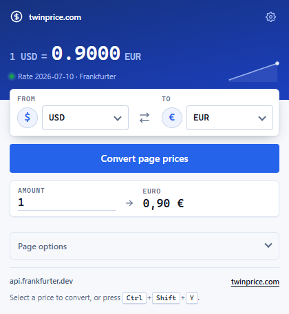
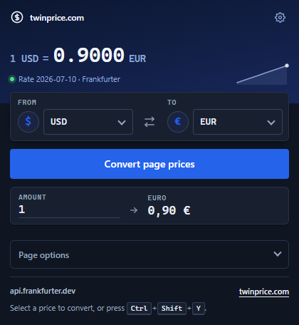
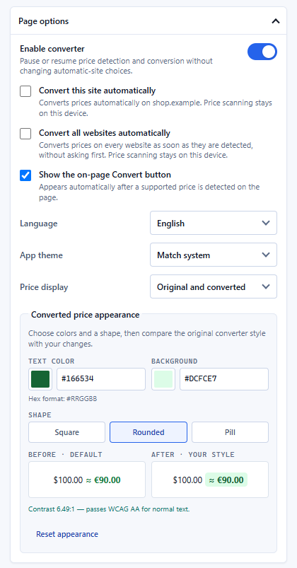
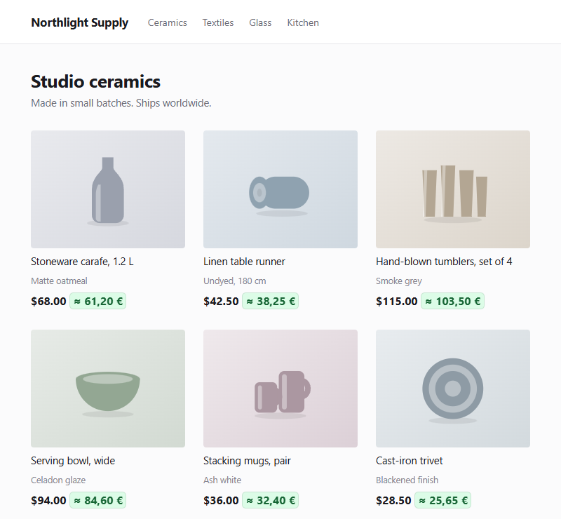

# 💱 Twinprice

Twinprice is a Chrome and Firefox extension that converts prices on shopping pages into a currency you understand.

**[twinprice.com](https://twinprice.com/)** brings together installation links, help, privacy information, and source code. The add-on links to the website for product information and support. Follow the [illustrated user guide](https://twinprice.com/guide/) to convert a page or a selected price. The [product facts and publisher details](https://twinprice.com/about/) explain supported browsers, rate sources, limitations, and maintenance.

Detection, conversion, and rendering all happen inside your browser. The only thing that leaves it on its own is an ISO currency code such as `USD` or `EUR` — never page content or prices. A site's name is sent only when you press **Report this website** on a page that would not convert.

**Current version:** 2.7.2 · **Platforms:** Chrome and Firefox Manifest V3 · **Firefox:** 140+ · Android 142+ · **License:** MIT

[](https://github.com/somewordshere/twinprice/actions/workflows/verify.yml) [](https://chromewebstore.google.com/detail/twinprice-currency-conver/mocmiipnkiobjgjkfehpcmlapgjaepfk) [](https://addons.mozilla.org/en-US/firefox/addon/twinprice/) [](release/2.7.2/twinprice-2.7.2-chrome.zip) [](release/2.7.2/twinprice-2.7.2-firefox.zip)

**[What’s new →](WHATS-NEW.md)**

[Screenshots](#-screenshots) · [Features](#features) · [Use](#-how-to-use-it) · [How it works](#️-how-it-works) · [Detection](#-currency-detection-confidence) · [Privacy](#-privacy-and-permissions) · [Limitations](#️-limitations) · [Build](#️-building-a-release) · [Development](#-development)

## 📸 Screenshots

### The popup

| Live rate and conversion | Dark mode | Page options |
| --- | --- | --- |
|  |  |  |

### On the page

Prices are detected locally as a page opens. The prompt appears only once a supported price is found, and it states the rate before you accept. Left alone, it goes away after six seconds; it waits while the pointer or keyboard focus is on it, and once **Convert prices** is pressed it stays to show the result and **Undo**.

| Conversion offered | Whole page converted |
| --- | --- |
|  |  |

Or select a single price to convert just that one:

| Select any price | Converted in place |
| --- | --- |
|  |  |

Earlier screenshots are preserved in the [legacy screenshot archive](screenshots/old/README.md). They show the previous Currency Converter Pro interface.

## Features

- Search currencies by name or ISO code, with conservative **AUTO** detection when the source currency is unknown.
- Convert a complete shopping page, one highlighted price, or an amount typed into the popup.
- Handle prices added later by dynamic and single-page websites.
- Show converted prices beside the originals or replace them, with exact undo support.
- Customize converted-price text, background, and corner shape with a live before-and-after preview and contrast guidance.
- Choose whether the popup follows the system theme or always uses light or dark mode.
- Use the popup, the welcome page, and the on-page prompts in twenty-two languages (English, Czech, German, Spanish (Spain), Latin American Spanish, French, Indonesian, Italian, Malay, Dutch, Polish, Brazilian Portuguese, Romanian, Thai, Turkish, Ukrainian, Uzbek, Vietnamese, Japanese, Korean, Simplified Chinese, and Traditional Chinese), following the browser's language or chosen from **Page options**.
- Keep the popup focused on the current site, currency pair, and one adaptive page-conversion action, with less-used controls in closed disclosures.
- Scan ordinary webpages locally as they open and show the on-page conversion prompt only after a supported price is found.
- Remember a manual source currency or `AUTO` mode for websites that should convert automatically.
- Report a website that will not convert in one press, from the prompt, the conversion notice or the popup. Only its hostname is sent.
- Use recent cached rates immediately while refreshing them in the background.

## 🧭 How to use it

### Convert an entire page

Choose your target currency in the popup and set the source to **AUTO** or a specific currency. Select **Convert prices** on the page or use the popup’s conversion button. Select **Restore original prices** in the popup to undo.

### Customize converted prices

In **Page options**, use **Converted price appearance** to change price colors and shape. Use **App theme** and **Language** to change the interface.

### Convert a custom amount

In the popup, open **Convert a custom amount** and enter a value. Choose a source currency if **AUTO** hasn’t detected one.

### Convert one highlighted price

Highlight the price, right-click, and select **Convert selected currency**.

### Remember a website

In **Page options**, turn on **Convert this site automatically**. Twinprice remembers your source currency or **AUTO** for that site.

### Convert every website

In **Page options**, turn on **Convert all websites automatically** to convert supported prices without a prompt. Turn off **Enable converter** to stop all scanning and conversion.

## ⚙️ How it works

1. **Always-on local detection:** a lightweight content script runs on ordinary HTTP and HTTPS pages, scans locally for supported prices, and shows the conversion prompt only after a match is found.
2. **Local detection:** the extension checks visible price text, structured product metadata, currency codes, symbols, and page context inside the browser.
3. **Conservative matching:** ambiguous symbols such as `$`, `¥`, and `kr` are converted only when the page provides enough currency context.
4. **Rate lookup:** only ISO currency codes are sent to the public [Frankfurter API](https://frankfurter.dev/). Detection starts the relevant lookup in the background, and recent cached rates can be used immediately while they refresh.
5. **Local rendering:** converted values are inserted beside the original prices or replace them according to the selected display mode.
6. **Dynamic updates:** bounded background scans handle prices that appear after the initial page load without continuously rescanning the entire document.

## 🎯 Currency detection confidence

AUTO detection gives every supported currency a weighted score based on evidence found on the page:

$$
S(c)=100M+100J+75E+\min(30,10V)+20D+40K+15L+40H+P
$$

| Signal | Meaning | Weight |
| --- | --- | ---: |
| $M$ | Matching structured price metadata | 100 per match |
| $J$ | Matching JSON-LD `priceCurrency` | 100 per match |
| $E$ | Matching currency in embedded shop data | 75 per match |
| $V$ | Visible ISO currency-code occurrences | 10 each, up to 30 |
| $D$ | Matching country-code domain | 20 |
| $K$ | Matching canonical country-code domain | 40 |
| $L$ | Matching page language or region | 15 |
| $H$ | Known hostname with a verified local pricing currency | 40 |
| $P$ | Visible price symbols | 10 per unambiguous match or 15 per match that corroborates another signal, up to 30 per symbol group |

The currency with the highest score becomes the AUTO candidate. The runner-up score is also considered so that two competing currencies do not produce a misleadingly confident result.

- **High confidence:** the winning score is at least 70 and at least 20 points above second place.
- **Medium confidence:** the winning score is at least 30 and at least 10 points above second place.
- **Low confidence:** the evidence does not meet either threshold, so page conversion asks for a manually selected source currency.

These are heuristic confidence scores, not calibrated probabilities.

**Worked example.** JSON-LD identifies EUR, the domain is `.de`, and the page language is `de-DE`: EUR scores $100+20+15=135$. USD appears twice as visible text: 20 points. EUR clears both the 70-point floor and the 20-point gap, so detection reports **high confidence**.

## 🔐 Privacy and permissions

Twinprice detects and converts prices in your browser. Page text, prices, full URLs, and browsing history stay there. Twinprice fetches the currency catalog and looks up rates by ISO currency code through Frankfurter.

**Report this website** sends a public site's hostname, failure reason, browser, extension version, target currency, and interface language to Twinprice. Reports create or update a public GitHub issue. Firefox asks for permission on the first report.

| Permission | Why it is needed |
| --- | --- |
| `storage` | Saves settings and caches rates. |
| `contextMenus` | Adds right-click conversion for a selected price. |
| HTTP and HTTPS access | Runs the local price detector as pages open. |
| `activeTab` and `scripting` | Runs the detector on demand when it did not load. |
| `api.frankfurter.dev` | Fetches the currency catalog and rates. |
| Optional site access | Supports **Activate my open tabs** and **Convert all websites automatically**. |
| Firefox `websiteContent` declaration | Covers currency codes detected on a page and sent for rate lookups. |

See the [privacy policy](privacy-policy.md) for network metadata, storage, and deletion details.

## 🌍 Currency behavior

- Manual selection uses the exchange-rate provider's current active currency catalog.
- AUTO detection uses a curated set of currencies to reduce false positives.
- Structured product data and explicit ISO currency codes receive the strongest detection priority.
- Stock counts, dates, ratings, product model numbers, hidden content, and editable fields are excluded.
- Recently used currencies are shown first.
- Currency-native precision is respected, including zero-decimal JPY and three-decimal KWD.

## ⚠️ Limitations

- Prices inside images, closed shadow roots, and inaccessible cross-origin frames cannot be converted.
- Some unusual or heavily scripted price layouts may need a manually selected source currency.
- Cached rates warn after 48 hours and are never used after seven days.
- Rates are intended for convenient price comparison and may differ from bank or card-provider rates.

## 🛠️ Building a release

Prerequisites:

- Git
- Node.js 22 LTS (Node.js 20 or newer is supported)
- npm, included with Node.js

From a fresh clone:

```bash
git clone https://github.com/somewordshere/twinprice.git
cd twinprice
npm ci
npm run verify
npm run build
```

`npm ci` installs the exact development dependencies recorded in
`package-lock.json`. `npm run build` creates both browser packages. The
upload-ready ZIP files are written to `release/<version>/`, while unpacked
development builds are written to `dist/chrome/` and `dist/firefox/`.
[release/README.md](release/README.md) describes the folder layout and the
release-notes template, and `npm run release` runs the checks, Firefox lint and
build in one go.

Or build only one browser target:

```bash
npm run build:chrome
npm run build:firefox
```

The build composes `manifests/base.json` with the selected browser override and copies only `src/` runtime assets into each package. Tests, reports, documentation, source manifests, and development files are excluded from the release archives.

## 🧪 Development

```bash
npm ci                        # exact pinned dev dependencies
npm run verify                # project checks plus the unit suite
npm test                      # unit tests only
npm run test:browser          # Chrome extension tests, via Playwright
npm run test:browser:firefox  # real Firefox runtime test, via geckodriver
npm run lint:firefox          # web-ext validation of the Firefox package
```

CI runs every one of these on each push. `npm run build:icons` and `npm run build:store-assets` regenerate the extension icons and store imagery.

## 📦 Recent releases

Browse all published versions and download packages on [GitHub Releases](https://github.com/somewordshere/twinprice/releases).

| Version | Highlights | Download |
| --- | --- | --- |
| 2.7.2 | Converted-only no longer breaks prices on React and Vue shops; mixed-currency pages name a currency that could not convert; Croatian and Bulgarian shops count as euro | [Chrome](release/2.7.2/twinprice-2.7.2-chrome.zip) · [Firefox](release/2.7.2/twinprice-2.7.2-firefox.zip) |
| 2.7.1 | Chrome and Edge load exchange rates again: the Chrome Web Store had received the Firefox package as 2.7.0 | [Chrome](release/2.7.1/twinprice-2.7.1-chrome.zip) · [Firefox](release/2.7.1/twinprice-2.7.1-firefox.zip) |
| 2.7.0 | Latin American Spanish in the extension and website | [Chrome](release/2.7.0/twinprice-2.7.0-chrome.zip) · [Firefox](release/2.7.0/twinprice-2.7.0-firefox.zip) |
| 2.6.0 | Uzbek interface and help in Latin script | [Chrome](release/2.6.0/twinprice-2.6.0-chrome.zip) · [Firefox](release/2.6.0/twinprice-2.6.0-firefox.zip) |
| 2.5.5 | Argentine peso prices on Alquiler Argentina now convert in AUTO mode | [Chrome](release/2.5.5/twinprice-2.5.5-chrome.zip) · [Firefox](release/2.5.5/twinprice-2.5.5-firefox.zip) |
| 2.5.4 | Romanian, the twentieth language; the convert offer leaves after six seconds untouched; page messages move to the top-right corner; the rating ask comes at 5, 40 and 100 converted pages, in Edge too | [Chrome](release/2.5.4/twinprice-2.5.4-chrome.zip) · [Firefox](release/2.5.4/twinprice-2.5.4-firefox.zip) |
| 2.5.3 | Prices whose cents sit in a separate part, such as doz.pl's homepage tiles, convert at the full amount | [Chrome](release/2.5.3/twinprice-2.5.3-chrome.zip) · [Firefox](release/2.5.3/twinprice-2.5.3-firefox.zip) |
| 2.5.2 | After five converted pages, the page itself asks once for a rating; prices that load after the page count too | [Chrome](release/2.5.2/twinprice-2.5.2-chrome.zip) · [Firefox](release/2.5.2/twinprice-2.5.2-firefox.zip) |
| 2.5.1 | The right-click convert entry is shown in the browser's language; translation fixes for Traditional Chinese, Dutch and Italian | [Chrome](release/2.5.1/twinprice-2.5.1-chrome.zip) · [Firefox](release/2.5.1/twinprice-2.5.1-firefox.zip) |
| 2.5.0 | Six new interface languages: Czech, Indonesian, Malay, Thai, Vietnamese and Traditional Chinese | [Chrome](release/2.5.0/twinprice-2.5.0-chrome.zip) · [Firefox](release/2.5.0/twinprice-2.5.0-firefox.zip) |

See [What’s new](WHATS-NEW.md) for every release.

## 🗂️ Project structure

```text
src/          Shared extension runtime used by both browsers
  _locales/   Store name and summary in each listed language
  background/ Listener/router entry plus settings, site-preference, page-action, catalog, rate, onboarding, rating-reminder, and website-report services, over shared HTTP and catalog-snapshot helpers
  content/    Detection and conversion runtime, conversion registry, bounded mutation scheduler, and page UI
  icons/      Extension icons
  popup/      Popup UI, settings reconciliation controller, and Firefox's one-time website-report consent window
  shared/     Browser adapter, currency catalog, canonical settings schema, messages, page-access rules, and manifest-derived content-script injection
manifests/    Common manifest plus Chrome and Firefox overrides
dist/         Generated unpacked browser builds (not committed)
release/      One folder per version: release notes plus the Chrome and Firefox ZIPs
store/        Store listing text in twenty-one locales, dashboard answers, screenshots, and promo art
screenshots/  README screenshots and an old/ archive of the previous interface
scripts/      Manifest composition, validation, icon, screenshot, video, and release utilities
tests/        Unit, integration, fixture, Chrome Playwright, and Firefox runtime tests
website/      twinprice.com and its website-report Worker, deployed separately with Wrangler
```

## 📄 License

Twinprice is released under the [MIT License](LICENSE).
