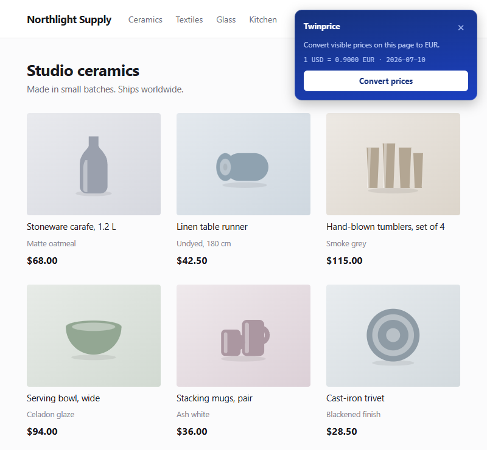
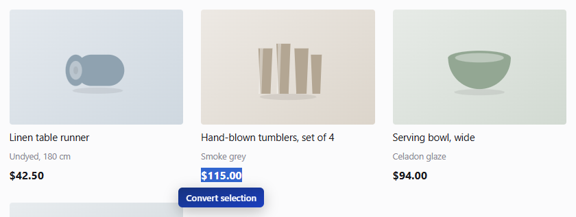
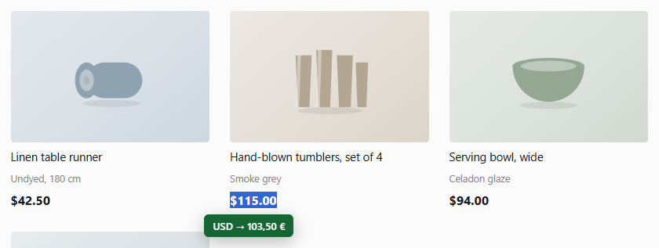

# 💱 Twinprice

Twinprice is a Chrome and Firefox extension that shows converted prices beside the originals on shopping pages.

[](https://chromewebstore.google.com/detail/twinprice-currency-conver/mocmiipnkiobjgjkfehpcmlapgjaepfk) [](https://addons.mozilla.org/en-US/firefox/addon/twinprice/)

**Quick start.** Choose your target currency in the Twinprice toolbar popup, then open a shopping page and select **Convert prices** when prompted. You can also start conversion from the popup.


Twinprice detects and converts prices locally in your browser. It fetches exchange rates using currency codes such as `USD` or `EUR`. See [Privacy and permissions](#-privacy-and-permissions) for details.

[Website](https://twinprice.com/) · [Illustrated user guide](https://twinprice.com/guide/) · [Product and publisher details](https://twinprice.com/about/) · [What’s new](WHATS-NEW.md)

**Current version:** 2.7.0 · **Platforms:** Chrome and Firefox Manifest V3 · **Firefox:** 140+ · Android 142+ · **License:** MIT

[](https://github.com/somewordshere/twinprice/actions/workflows/verify.yml) [](release/2.7.0/twinprice-2.7.0-chrome.zip) [](release/2.7.0/twinprice-2.7.0-firefox.zip)

[Screenshots](#-screenshots) · [Features](#features) · [Install](#installation) · [Use](#-how-to-use-it) · [How it works](#️-how-it-works) · [Detection](#-currency-detection-confidence) · [Privacy](#-privacy-and-permissions) · [Limitations](#️-limitations) · [Build](#️-building-a-release) · [Development](#-development)

## 📸 Screenshots

### The popup

| Live rate and conversion | Dark mode | Page options |
| --- | --- | --- |
|  |  |  |

### On the page

Prices are detected locally as a page opens. The prompt appears only once a supported price is found, and it states the rate before you accept. Left alone, it goes away after six seconds; it waits while the pointer or keyboard focus is on it, and once **Convert prices** is pressed it stays to show the result and **Undo**.



Or select a single price to convert just that one:

| Select any price | Converted in place |
| --- | --- |
|  |  |

Earlier screenshots are preserved in the [legacy screenshot archive](screenshots/old/README.md). They show the previous Currency Converter Pro interface.

## Features

- Search currencies by name or ISO code, with conservative **AUTO** detection when the source currency is unknown.
- Convert a complete shopping page, one highlighted price, or an amount typed into the popup.
- Handle prices added later by dynamic and single-page websites.
- Show converted prices beside the originals or replace them, with exact undo support.
- Customize converted-price text, background, and corner shape with a live before-and-after preview and contrast guidance.
- Choose whether the popup follows the system theme or always uses light or dark mode.
- Use the popup, the welcome page, and the on-page prompts in twenty-two languages (English, Czech, German, Spanish (Spain), Latin American Spanish, French, Indonesian, Italian, Malay, Dutch, Polish, Brazilian Portuguese, Romanian, Thai, Turkish, Ukrainian, Uzbek, Vietnamese, Japanese, Korean, Simplified Chinese, and Traditional Chinese), following the browser's language or chosen from **Page options**.
- Keep the popup focused on the current site, currency pair, and one adaptive page-conversion action, with less-used controls in closed disclosures.
- Scan ordinary webpages locally as they open and show the on-page conversion prompt only after a supported price is found.
- Remember a manual source currency or `AUTO` mode for websites that should convert automatically.
- Use **Report this website** when conversion fails. Submitting a report sends the site’s hostname and diagnostic details and can create a public GitHub issue. See [Privacy and permissions](#-privacy-and-permissions) for the fields sent.
- Use recent cached rates immediately while refreshing them in the background.

## Installation

- **Store installation:** Install Twinprice from the [Chrome Web Store](https://chromewebstore.google.com/detail/twinprice-currency-conver/mocmiipnkiobjgjkfehpcmlapgjaepfk) or [Firefox Add-ons](https://addons.mozilla.org/en-US/firefox/addon/twinprice/).
- **Manual installation:** Download the latest [Chrome build](release/2.7.0/twinprice-2.7.0-chrome.zip) or [Firefox build](release/2.7.0/twinprice-2.7.0-firefox.zip), extract it, and load it through the browser's extension-development page. The Firefox build requires Mozilla signing for permanent installation.

## 🧭 How to use it

### Convert an entire page

1. Open an ordinary HTTP or HTTPS webpage. Twinprice scans locally for supported prices.
2. When a supported price is found, select **Convert prices** in the on-page prompt.
3. Use the toolbar popup to keep **AUTO** selected or choose a source currency manually, and select the target currency.
4. The popup action can also run conversion directly as **Turn on and convert page** or **Convert page prices**.
5. **Restore original prices** appears only after the page contains conversions.

The global **Enable converter** switch is under **Page options**. Turning it off stops local price scanning, prompts, and automatic conversion until the user enables it again.

### Customize converted prices

Open **Page options** and use **Converted price appearance** to choose text and background colors plus a square, rounded, or pill shape. The **Before** sample keeps the original converter style while **After** updates as you edit. The contrast message reports whether the selected colors meet WCAG AA for normal text, and **Reset appearance** restores the accessible green default.

Use **App theme** in the same panel to match the browser's system theme or keep the popup in light or dark mode. The choice is synchronized with the rest of the extension settings.

Use **Language** in the same panel to pick the interface language. **Automatic** follows the browser's language and falls back to English; the other entries are named in their own language so they can be found from any starting point. The choice applies to the popup, the welcome page, and the on-page prompt, button, and messages. Messages that come from the exchange-rate provider, such as a rate being unavailable, stay in English.

### Convert a custom amount

Open the closed **Convert a custom amount** section and enter a value. The popup calculates the result without inspecting the current webpage. If the source is still `AUTO` and no page conversion has identified it, select an explicit source currency first.

### Convert one highlighted price

Highlight a supported price and use the **Convert selected currency** right-click action. The on-page conversion prompt appears automatically when local detection finds a supported price and the prompt option is enabled.

### Remember a website

Open **Page options** and enable **Convert this site automatically**. The selected manual source or `AUTO` mode is remembered for that origin, and supported prices are converted when the site is visited. Turning this option off deletes the saved origin and source mode; ordinary local price detection and the conversion prompt remain available.

### Convert every website

Open **Page options** and enable **Convert all websites automatically**. Every website then converts its supported prices as soon as they are detected, without the on-page prompt or a notice. It is off by default. Turning it off restores the original prices on pages it converted; websites chosen with **Convert this site automatically** keep converting.

## ⚙️ How it works

1. **Always-on local detection:** a lightweight content script runs on ordinary HTTP and HTTPS pages, scans locally for supported prices, and shows the conversion prompt only after a match is found.
2. **Local detection:** the extension checks visible price text, structured product metadata, currency codes, symbols, and page context inside the browser.
3. **Conservative matching:** ambiguous symbols such as `$`, `¥`, and `kr` are converted only when the page provides enough currency context.
4. **Rate lookup:** only ISO currency codes are sent to the public [Frankfurter API](https://frankfurter.dev/). Detection starts the relevant lookup in the background, and recent cached rates can be used immediately while they refresh.
5. **Local rendering:** converted values are inserted beside the original prices or replace them according to the selected display mode.
6. **Dynamic updates:** bounded background scans handle prices that appear after the initial page load without continuously rescanning the entire document.

## 🎯 Currency detection confidence

AUTO detection gives every supported currency a weighted score based on evidence found on the page:

$$
S(c)=100M+100J+75E+\min(30,10V)+20D+40K+15L+40H+P
$$

| Signal | Meaning | Weight |
| --- | --- | ---: |
| $M$ | Matching structured price metadata | 100 per match |
| $J$ | Matching JSON-LD `priceCurrency` | 100 per match |
| $E$ | Matching currency in embedded shop data | 75 per match |
| $V$ | Visible ISO currency-code occurrences | 10 each, up to 30 |
| $D$ | Matching country-code domain | 20 |
| $K$ | Matching canonical country-code domain | 40 |
| $L$ | Matching page language or region | 15 |
| $H$ | Known hostname with a verified local pricing currency | 40 |
| $P$ | Visible price symbols | 10 per unambiguous match or 15 per match that corroborates another signal, up to 30 per symbol group |

The currency with the highest score becomes the AUTO candidate. The runner-up score is also considered so that two competing currencies do not produce a misleadingly confident result.

- **High confidence:** the winning score is at least 70 and at least 20 points above second place.
- **Medium confidence:** the winning score is at least 30 and at least 10 points above second place.
- **Low confidence:** the evidence does not meet either threshold, so page conversion asks for a manually selected source currency.

These are heuristic confidence scores, not calibrated probabilities.

**Worked example.** JSON-LD identifies EUR, the domain is `.de`, and the page language is `de-DE`: EUR scores $100+20+15=135$. USD appears twice as visible text: 20 points. EUR clears both the 70-point floor and the 20-point gap, so detection reports **high confidence**.

## 🔐 Privacy and permissions

All webpage scanning, price detection, conversion, and rendering happen locally inside the browser. The extension never transmits page contents, highlighted text, price values, visited URLs, or browsing history.

When a conversion fails, the prompt, the conversion notice and the popup offer **Report this website**. Pressing it sends the site's hostname (never its path, query or contents), the failure reason, the extension version and browser, and the target currency and interface language to `twinprice.com/api/report`, which files one public GitHub issue per website. Names of private networks (`.local`, `.corp`, `.internal` and similar) are never sent, and the endpoint refuses any name that public DNS does not know or that points only at private addresses. Firefox asks for permission the first time. The endpoint is the Worker in [`website/worker.js`](website/worker.js).

Apart from a website report the user sends, the only external requests retrieve the currency catalog and reference rates from Frankfurter using ISO currency codes. No webpage text, prices, URLs, analytics, tracking identifiers, or advertising data is included. As with any HTTPS request, the service may receive ordinary network metadata such as an IP address. Preferences, recent currency choices, cached rates, and origins selected for automatic conversion remain in browser storage.

| Permission | Why it is needed |
| --- | --- |
| `storage` | Saves settings, recent currencies, automatic-conversion origins, their source modes, cached rates, and the local rating-reminder count. |
| `contextMenus` | Adds the right-click command for a highlighted price. |
| HTTP and HTTPS webpage access | Loads the local detector as pages open so it can find supported prices and offer conversion without a toolbar click. Page contents and URLs are not transmitted. |
| `activeTab` and `scripting` | Provides a user-triggered fallback on supported pages where the normal detector was not loaded, including manually allowed local files. |
| `api.frankfurter.dev` | Retrieves reference exchange rates using ISO currency codes. |
| Optional HTTP and HTTPS site access | Requested when you click **Activate my open tabs**, allowing the detector to start in existing tabs without reloading them. You can decline and reload those tabs instead. Turning on **Convert all websites automatically** asks for the same access if the browser has not granted it. |
| Firefox `websiteContent` data declaration | Discloses that a source ISO currency code detected from the page can be transmitted to the rate provider; raw page text, prices, and URLs are not transmitted. |

Read the complete [privacy policy](privacy-policy.md) for retention, deletion, and provider details.

## 🌍 Currency behavior

- Manual selection uses the exchange-rate provider's current active currency catalog.
- AUTO detection uses a curated set of currencies to reduce false positives.
- Structured product data and explicit ISO currency codes receive the strongest detection priority.
- Stock counts, dates, ratings, product model numbers, hidden content, and editable fields are excluded.
- Recently used currencies are shown first.
- Currency-native precision is respected, including zero-decimal JPY and three-decimal KWD.

## ⚠️ Limitations

- Prices inside images, closed shadow roots, and inaccessible cross-origin frames cannot be converted.
- Some unusual or heavily scripted price layouts may need a manually selected source currency.
- Cached rates warn after 48 hours and are never used after seven days.
- Rates are intended for convenient price comparison and may differ from bank or card-provider rates.

## 🛠️ Building a release

Prerequisites:

- Git
- Node.js 22 LTS (Node.js 20 or newer is supported)
- npm, included with Node.js

From a fresh clone:

```bash
git clone https://github.com/somewordshere/twinprice.git
cd twinprice
npm ci
npm run verify
npm run build
```

`npm ci` installs the exact development dependencies recorded in
`package-lock.json`. `npm run build` creates both browser packages. The
upload-ready ZIP files are written to `release/<version>/`, while unpacked
development builds are written to `dist/chrome/` and `dist/firefox/`.
[release/README.md](release/README.md) describes the folder layout and the
release-notes template, and `npm run release` runs the checks, Firefox lint and
build in one go.

Or build only one browser target:

```bash
npm run build:chrome
npm run build:firefox
```

The build composes `manifests/base.json` with the selected browser override and copies only `src/` runtime assets into each package. Tests, reports, documentation, source manifests, and development files are excluded from the release archives.

## 🧪 Development

```bash
npm ci                        # exact pinned dev dependencies
npm run verify                # project checks plus the unit suite
npm test                      # unit tests only
npm run test:browser          # Chrome extension tests, via Playwright
npm run test:browser:firefox  # real Firefox runtime test, via geckodriver
npm run lint:firefox          # web-ext validation of the Firefox package
```

CI runs every one of these on each push. `npm run build:icons` and `npm run build:store-assets` regenerate the extension icons and store imagery.

## 📦 Recent releases

See the [changelog](CHANGELOG.md) for the full history and [GitHub Releases](https://github.com/somewordshere/twinprice/releases) for older downloads.

| Version | Highlights | Download |
| --- | --- | --- |
| 2.7.0 | Latin American Spanish in the extension and website | [Chrome](release/2.7.0/twinprice-2.7.0-chrome.zip) · [Firefox](release/2.7.0/twinprice-2.7.0-firefox.zip) |
| 2.6.0 | Uzbek interface and help in Latin script | [Chrome](release/2.6.0/twinprice-2.6.0-chrome.zip) · [Firefox](release/2.6.0/twinprice-2.6.0-firefox.zip) |
| 2.5.5 | Argentine peso prices on Alquiler Argentina now convert in AUTO mode | [Chrome](release/2.5.5/twinprice-2.5.5-chrome.zip) · [Firefox](release/2.5.5/twinprice-2.5.5-firefox.zip) |

## 🗂️ Project structure

```text
src/          Shared extension runtime used by both browsers
  _locales/   Store name and summary in each listed language
  background/ Listener/router entry plus settings, site-preference, page-action, catalog, rate, onboarding, rating-reminder, and website-report services, over shared HTTP and catalog-snapshot helpers
  content/    Detection and conversion runtime, conversion registry, bounded mutation scheduler, and page UI
  icons/      Extension icons
  popup/      Popup UI, settings reconciliation controller, and Firefox's one-time website-report consent window
  shared/     Browser adapter, currency catalog, canonical settings schema, messages, page-access rules, and manifest-derived content-script injection
manifests/    Common manifest plus Chrome and Firefox overrides
dist/         Generated unpacked browser builds (not committed)
release/      One folder per version: release notes plus the Chrome and Firefox ZIPs
store/        Store listing text in twenty-one locales, dashboard answers, screenshots, and promo art
screenshots/  README screenshots and an old/ archive of the previous interface
scripts/      Manifest composition, validation, icon, screenshot, video, and release utilities
tests/        Unit, integration, fixture, Chrome Playwright, and Firefox runtime tests
website/      twinprice.com and its website-report Worker, deployed separately with Wrangler
```

## 📄 License

Twinprice is released under the [MIT License](LICENSE).
